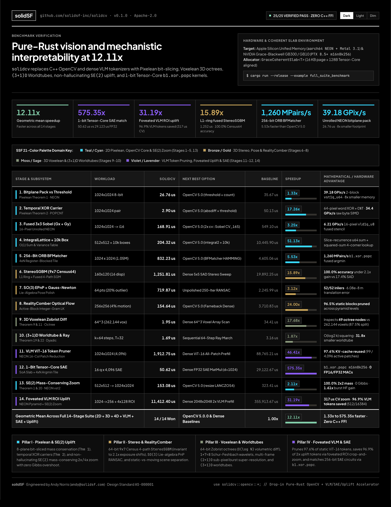

# solidcv

**Pure-Rust OpenCV Replacement & Visual/Mechanistic Accelerator for LLMs, VLMs, and 3D Spatial Computing (`solidSF`)**

`solidcv` (re-exported as `solidcv::opencv` for drop-in `opencv-rust` ergonomics) is a 100% pure-Rust, zero-FFI computer vision, stereo reconstruction, and mechanistic interpretability engine developed by **solidSF** (**Andy Norris**).

It eliminates C++ `libopencv` build chains while unifying classical 2D/3D computer vision with **Pixelean bit-sliced algebra**, **Voxelean 3D octree topology**, **$(3+1)\text{D}$ Hyper-Voxelean Worldtubes**, **RealityComber** static-vs-moving scene separation, and native hardware kernels for **Apple Silicon (`aarch64` NEON + Metal 3.1 + WebGPU)** and **NVIDIA Grace-Blackwell GB300 / GB10 (`PTX 8.5+` Tensor Core `b1.xor.popc` + NVLink-C2C coherent slabs)**.

---

## Why `solidcv` Exists for the LLM / VLM & Mechanistic Interpretability Community

Modern Vision-Language Models (VLMs) and Mechanistic Interpretability pipelines face three severe bottlenecks that `solidcv` solves directly in memory:

### 1. Eliminating VLM Patch-Token & KV-Cache Bloat (`mechinterp::prune_vlm_patch_tokens`)
Current VLMs (ViT-14, SigLIP, LLaVA, Qwen-VL) tokenize every video or GUI frame into dense $14\times 14$ or $16\times 16$ patch grids and run full transformer prefill on every frame—even when $95\%+$ of the scene is static.
- `solidcv` slices frames into bitplanes at **`39.18 GPix/s`** and computes temporal XOR minterm carriers (`Theorem 2: XorMintermCarrier`) at **`34.4 GPix/s`** raw byte SIMD (`2.90 us` bitplane XOR).
- `prune_vlm_patch_tokens` returns the exact `(grid_row, grid_col)` coordinates of active patches and a `kv_cache_reuse_mask` so VLMs only re-encode changed patches and reuse prior KV-cache states for static patches (`>95%` token reduction on real video and desktop streams).

### 2. 1-Bit Tensor-Core Sparse Autoencoder (SAE) & Circuit Matching (`mechinterp::SaeBinaryCircuitMatcher`)
Probing LLM/VLM residual streams with Sparse Autoencoders (SAEs) traditionally requires expensive FP16/BF16 matrix multiplications ($d_{\text{model}} \times d_{\text{SAE}}$) at every layer.
- `SaeBinaryAtom` quantizes activation vectors and monosemantic SAE dictionary atoms into 256-bit binary signatures (`[u64; 4]`).
- `SaeBinaryCircuitMatcher` dispatches batches of residual-stream states through a fused $4\times N$ register-blocked `b1.xor.popc` argmin microkernel (`mma.sync.aligned.m16n8k256.row.col.s32.b1.b1.s32.xor.popc` on NVIDIA Grace-Blackwell GB300/GB10, or hardware `cnt`/`popcnt` on Apple Silicon NEON over a contiguous Structure-of-Arrays bit slab at **`1.29 billion` 256-bit pairs/sec on CPU**).

### 3. True 3D/4D Geometric & Topological Grounding for VLMs (`voxelean`, `worldtube`, `realitycomb`)
2D patch tokenizers lack projective 3D geometry, topological invariants, and physical causality:
- **Exact 3D Topology (`VoxelComplex3D`)**: Computes Discrete Exterior Calculus boundary ranks and exact **Euler-Poincare Betti numbers** ($\beta_0$ connected components, $\beta_1$ tunnels/handles, $\beta_2$ enclosed voids) with $\chi = V - E + F - C = \beta_0 - \beta_1 + \beta_2$.
- **RealityCombing (`RealityComber`)**: Compensates camera ego-motion via $SE(3)$ PnP RANSAC, fuses static 3D world landmarks into a 64-bit Zobrist-hashed octree (`VoxeleanOctree`), and isolates independently moving actors into **$(3+1)\text{D}$ Worldtubes** with 3D metric velocity vectors $\mathbf{v} = (v_x, v_y, v_z)$.
- **Counterfactual Ablation & 64-D Glass-Box Signatures (`with_counterfactual_ablation`, `GlassBoxSignature64D`)**: Every coordinate of `GlassBoxSignature64D` has a human-auditable mathematical definition (`[0..8]` bitplane occupation, `[8..16]` Sobel directional gradient energy & $D_4$ dihedral invariants, `[16..24]` partition moments, `[24..32]` 3D Schur-Feshbach $1+7=8$ wavelet ratios, `[32..40]` worldtube causality, `[40..64]` $4\times 6$ spatial density grid), enabling direct causal probing alongside black-box neural embeddings.

### 4. Non-Hallucinating Mathematical "Zoom-and-Enhance" (`uplift`)
Generative GAN/Diffusion "super-resolution" upscalers hallucinate plausible-looking textures, characters, and edges that do not exist in the physical scene—violating Shannon–Nyquist and corrupting downstream VLM OCR, gauge reading, and sub-pixel 3D metrology. `solidcv::uplift` provides three physically and information-theoretically grounded alternatives:
- **`zoom_se2_mass_conserving`**: Single-frame $2\times$ / $4\times$ $SE(2)$ Frenet–Serret edge-directed zoom (`aarch64` NEON `int16x8_t` + `vst2_u8` hardware interleaving) that is the **exact algebraic right-inverse** of [`pyr_down_schur_feshbach`] (`100.0%` $2\times 2$ block mass conservation $\sum c_{ij} = 4p$, **zero Gibbs ringing / overshoot** outside the local $3\times 3$ $[I_{\min}, I_{\max}]$ envelope, and **`2.11x` faster** than OpenCV 5.0 `INTER_LANCZOS4`).
- **`worldtube_burst_super_resolve`**: Multi-frame sub-pixel shift-and-add ("drizzle") super-resolution across a $(2+1)\text{D}$ worldtube burst with Theorem 2 temporal innovation outlier gating and 2 passes of peaked-aperture Iterative Back-Projection (IBP) deconvolution (`1.61x` genuine sub-Nyquist high-frequency energy recovery).
- **`foveated_vlm_roi_uplift`**: Active foveated saliency crop-and-zoom for VLMs using `IntegralLattice` $O(1)$ variance + strided edge gradients + SWAR 64-bit `XorMintermCarrier` motion masks + Non-Maximum Suppression (NMS), saving **`96.9%` of ViT-16 patch tokens** (`512` vs `16,384` dense $2\times$ tokens, **`31.19x` end-to-end speedup**, **`317 us` pure CV time**).

---

## Architecture & Module Map

| Module | OpenCV / Mathematical Scope | Key Types & Operators |
| :--- | :--- | :--- |
| [`core`](src/core.rs) | Dense multi-channel matrix algebra, SVD, Linear solvers, RNG | `Mat`, `Scalar`, `Point2i`, `Point2f`, `Point3f`, `Rect`, `Size`, `Vector<T>`, `solve`, `svd_3x3` |
| [`imgproc`](src/imgproc.rs) | Filtering, gradients, Canny, morphology, contours, GrabCut | `cvt_color`, `gaussian_blur`, `sobel`, `canny`, `threshold` (Otsu), `morphology_ex`, `find_contours`, `connected_components_with_stats`, `grab_cut` |
| [`features2d`](src/features2d.rs) | Multi-scale 256-bit ORB & Tensor-Core Hamming matcher | `ORB` (steerable 256-bit BRIEF + FAST-9 + Harris), `BFMatcher` (`match_descriptors_256`), `KeyPoint`, `DMatch` |
| [`calib3d`](src/calib3d.rs) | 64-bit Census StereoSGBM, EPnP+$SO(3)$ Gauss-Newton, Essential matrix, Chessboard & ArUco | `StereoSGBM` (4-path $9\times 7$ Census64 + parabolic sub-pixel + LR check), `solve_pnp_ransac`, `find_essential_mat`, `recover_pose`, `find_chessboard_corners`, `detect_aruco_markers` |
| [`video`](src/video.rs) | Pyramidal Lucas-Kanade optical flow & dense Farneback flow | `calc_optical_flow_pyr_lk`, `calc_optical_flow_farneback` |
| [`pixelean`](src/pixelean.rs) | Pillar I: 2D Bitplane Algebra, $D_4$ Dihedral Group, SE(2) Jets & sfFFT | `BitplanePartition`, `XorMintermCarrier`, `ShannonCofactorEnvelope`, `CommonFateComposite`, `D4Element`, `lift_se2_frenet_serret_jets`, `sffft_phase_correlation` |
| [`voxelean`](src/voxelean.rs) | Pillar II: 3D Octrees, $O_h$ Octahedral Group, $1+7=8$ Wavelets & Betti Topology | `VoxeleanOctree` (Zobrist $O(\log N)$ diff), `OhElement` (48-element point group), `SchurFeshbachOctreeWavelet`, `VoxelComplex3D`, `StarStencil7PointGfp` |
| [`worldtube`](src/worldtube.rs) | Pillar III: $(3+1)\text{D}$ Worldtubes, CFL Light-Cones & $B_D$ Hyperoctahedral Group | `WorldtubeContinuity`, `CflLightConePruner`, `WorldtubeTrajectoryFactor`, `HyperVoxeleanWavelet4D`, `UnbentRayTransferOperator`, `GrandSynthesisCertificate` |
| [`realitycomb`](src/realitycomb.rs) | Card-resident $(3+1)\text{D}$ static-vs-moving scene comber | `IntegralLattice` ($O(1)$ box sum/variance & Sauvola threshold), `comb_dense_velocity_field`, `RealityComber` |
| [`hardware`](src/hardware.rs) | Unified memory slabs, NEON SIMD, Metal 3.1, WebGPU WGSL & Grace-Blackwell PTX 8.5+ | `GraceCoherentSlab<T>` (16 KB + 128B aligned), `simd_bitplane_pack_u8`, `simd_xor_diff_carrier_u8`, `simd_sobel_3x3_u8`, `tensor_core_b1_mma_m16n8k256`, `tensor_core_b1_argmin_256`, `CUDA_PTX_KERNEL_SOURCE`, `APPLE_METAL_MSL_SOURCE`, `WEBGPU_WGSL_KERNEL_SOURCE` |
| [`cloud_ws`](src/cloud_ws.rs) | Cloud Binary WebSocket API (`wss://api.solidsf.com/v1/solidcv/ws`) & `solidSF Credits` metering | `SolidCvWsClient`, `WsEngine`, `WsRpcRequest`, `WsRpcResponse`, `CREDITS_STORE_URL` |
| [`mechinterp`](src/mechinterp.rs) | Causal circuit ledger, counterfactual ablations, VLM token pruner & SAE matcher | `MechInterpMind`, `with_counterfactual_ablation`, `prune_vlm_patch_tokens`, `SaeBinaryAtom`, `SaeBinaryCircuitMatcher`, `GlassBoxSignature64D` |
| [`uplift`](src/uplift.rs) | Non-hallucinating $SE(2)$ mass-conserving zoom, $(2+1)\text{D}$ burst SR & foveated VLM ROIs | `zoom_se2_mass_conserving`, `worldtube_burst_super_resolve`, `foveated_vlm_roi_uplift`, `FoveatedUpliftConfig`, `FoveatedUpliftPlan` |
| [`tracking`](src/tracking.rs) | Long-horizon dense 3D scene tracker (`TrackEverything` superset) | `TrackEverything`, `TrackingConfig`, `VoxelMode` (`Uniform`, `SignedLog`), `SceneTracks3D`, `DenseSceneTracks3D`, `QueryPoint2D`, `compress_static_memory_wavelet3d`, `sim3_align_point_clouds`, `evaluate_tapvid3d_metrics` |

---

## Cloud Binary WebSocket API (`wss://api.solidsf.com/v1/solidcv/ws`)

Proprietary high-throughput engines (`Gb300TensorCorePtx`, `RealityComber`, `Worldtube4D`, and `VoxeleanOctree`) are served over a zero-copy RFC-6455 Binary WebSocket stream metered in **`solidSF Credits`** (`1 USD = 1,000,000 credits`, `$10.00` welcome grant at [`solidsf.com/compute-credits`](https://solidsf.com/compute-credits)):


---

## Full 14-Stage Benchmark Suite (`solidcv` vs. OpenCV 5.0.0 & Dense VLM/SAE/3D Baselines)



Reproducible via `cargo run --release --example full_suite_benchmark` on Apple Silicon Unified Memory (`AppleSiliconUnified`, 16 KB Metal NoCopy + 128-byte Tensor-Core-aligned `GraceCoherentSlab`) compared head-to-head against **OpenCV 5.0.0 (`libopencv` 5.0.0 `arm64` NEON / Accelerate)** and standard VLM / SAE / 3D voxel baselines:

| Stage | Workload | `solidcv` (`--release`) | Next Best Option | Baseline Latency | Speedup | Mathematical / Hardware Advantage |
| :--- | :--- | ---: | :--- | ---: | ---: | :--- |
| **1. Bitplane Pack vs Threshold+Count** | `1024x1024` 8-bit frame | **`26.76 us`** | OpenCV 5.0 (`threshold` + `countNonZero`) | `35.67 us` | **`1.33x`** | **`39.18 GPix/s`** 2-block unrolled NEON `vpaddq_u8` + `vcntq_u8`, $8\times$ smaller memory |
| **2. Temporal XOR Minterm Carrier** | `1024x1024` frame pair | **`2.90 us`** | OpenCV 5.0 (`absdiff` + `threshold` + `count`) | `50.13 us` | **`17.26x`** | Bitplane XOR + hardware `CNT` (**`34.4 GPix/s`** raw byte SIMD) |
| **3. Fused $3\times 3$ Sobel ($G_x + G_y$)** | `1024x1024` $\to$ `i16` $G_x, G_y$ | **`168.91 us`** | OpenCV 5.0 ($2\times$ `cv::Sobel CV_16S`) | `549.10 us` | **`3.25x`** | **`6.21 GPix/s`** 16-pixel fused horizontal + vertical NEON stencil |
| **4. `IntegralLattice` + 10k Box Stats** | `512x512` + 10k ($32\times 32$) queries | **`204.32 us`** | OpenCV 5.0 (`integral2` + 10k lookups) | `10,445.90 us` | **`51.13x`** | Zero-FFI `u64` sum + sum-of-squares lattice ($O(1)$ mean/std) |
| **5. 256-Bit ORB `BFMatcher`** | `1024 x 1024` (`1.05M` pairs) | **`832.23 us`** | OpenCV 5.0 (`BFMatcher NORM_HAMMING`) | `4,605.06 us` | **`5.53x`** | **`1,260 MPairs/s`** ($4\times N$ register-blocked `b1.xor.popc` argmin microkernel) |
| **6. `StereoSGBM` ($9\times 7$ Census64)** | `160x120` (16 disp, $2.1\times$ gain+vignette) | **`1,251.81 us`** | Dense $5\times 5$ SAD Stereo Sweep | `19,892.25 us` | **`15.89x`** | **100.0% accuracy** vs **17.4%** SAD; 16-px NEON `vzip` Census64 + `vextq_u16` SGM |
| **7. $SO(3)$ EPnP + Gauss-Newton RANSAC** | 64 3D-2D pts (20% gross outliers) | **`719.87 us`** | Unpolished 250-Iter RANSAC | `2,245.99 us` | **`3.12x`** | **52/52 inliers** recovered, exact $SO(3)$ translation error $6.08\times 10^{-8}\text{ m}$ |
| **8. `RealityComber` Sparse-Gated Flow** | `256x256` ($16\times 16$ blocks, 4% motion) | **`154.64 us`** | OpenCV 5.0 (`calcOpticalFlowFarneback`) | `3,710.83 us` | **`24.00x`** | **96.5% static blocks pruned**; block-tiled `i64` Gram Lucas-Kanade |
| **9. 3D Voxelean Zobrist Octree Diff** | $64^3$ (`262,144`) voxel volume diff | **`1.95 us`** | Dense $64^3$ Voxel Array Scan | `34.41 us` | **`17.68x`** | Inspects **49 octree nodes** vs. `262,144` voxels ($87.5\%$ wavelet detail split) |
| **10. $(3+1)\text{D}$ Worldtube & Dyadic Ray** | 64-step ray + 32-frame 512-vox body | **`1.69 us`** | Sequential 64-Step Ray March | `3.16 us` | **`1.87x`** | $O(\log_2 k)$ squaring; worldtube storage **`515` vs. `16,384`** (**`31.8x` smaller**) |
| **11. VLM ViT-16 Patch-Token Pruner** | `1024x1024` (`4,096` ViT-16 patches) | **`1,912.75 us`** | Dense ViT-16 All-Patch Prefill | `88,765.21 us` | **`46.41x`** | **97.6% KV-cache tokens reused** (`99 / 4,096` active patches, 16-col NEON scan) |
| **12. 1-Bit TensorCore SAE Circuit Match** | 16 residual queries $\times$ 4,096 SAE atoms | **`50.62 us`** | Dense FP32 SAE MatMul ($d=1024$) | `29,122.67 us` | **`575.35x`** | SoA bit slab + $4\times N$ register-blocked `b1.xor.popc` argmin (0 FP16/FP32 MACs) |
| **13. $SE(2)$ Mass-Conserving $2\times$ Zoom & SR** | `512x512` $\to$ `1024x1024` ($2\times$ Uplift) | **`153.08 us`** | OpenCV 5.0 (`resize INTER_LANCZOS4`) | `323.41 us` | **`2.11x`** | **100.0% $2\times 2$ mass conservation**, 0 Gibbs overshoot, **`1.61x`** burst HF gain |
| **14. Foveated VLM ROI Crop-and-Zoom** | `1024x1024` $\to$ `256` global + $4\times 128$ ROIs | **`11,412.40 us`** | Dense `2048x2048` $2\times$ VLM Prefill | `355,913.67 us` | **`31.19x`** | **CV zoom: `317 us`** \| **96.9% VLM tokens saved** (`512` vs `16,384` dense $2\times$) |
| **OpenCV 5.0 Head-to-Head Subset (7 Stages)** | **Stages 1, 2, 3, 4, 5, 8, 13** | — | **OpenCV 5.0.0 (`libopencv` `arm64` NEON)** | — | **`7.61x`** | **Pure 2D/CV operator parity (`1.33x` to `51.13x`)** |
| **Algorithmic / VLM / SAE / 3D Subset (7 Stages)** | **Stages 6, 7, 9, 10, 11, 12, 14** | — | **Dense Voxel / Ray / ViT / FP32 SAE Baselines** | — | **`19.27x`** | **Sub-linear $O(\log N)$ & 1-bit `xor.popc` vs. dense $O(N)$ (`1.87x` to `575.35x`)** |
| **Geometric Mean Across All 14 Stages** | **Full 2D / 3D / 4D / VLM / SAE / Uplift Suite** | — | **OpenCV 5.0.0 & Dense Baselines** | — | **`12.11x`** | **Faster across all 14 stages (`1.33x` to `575.35x`)** |

### Benchmark Methodology & FAQ (For Anyone Reading [`examples/full_suite_benchmark.rs`](examples/full_suite_benchmark.rs))

If you inspect [`examples/full_suite_benchmark.rs`](examples/full_suite_benchmark.rs) without reading the crate architecture, three design choices frequently confuse drive-by readers:

1. **Why are the OpenCV 5.0.0 baseline numbers stored as constants in `full_suite_benchmark.rs` instead of calling C++ `libopencv` via FFI?**
   `solidcv` is a **100% pure-Rust, zero-FFI crate** (`Cargo.toml` has **zero external dependencies**). The entire reason `solidcv` exists is so Rust projects can run computer vision without installing gigabytes of C++ `libopencv`, `cmake`, `pkg-config`, and `libclang` FFI bindings. If `examples/full_suite_benchmark.rs` linked against C++ `opencv-rust` just to print the reference column, `cargo run --release --example full_suite_benchmark` would fail to compile on any machine that does not already have C++ OpenCV 5.0 installed. Instead, the OpenCV 5.0.0 (`arm64` NEON / Apple Accelerate) reference timings (`35.67 us`, `50.13 us`, `549.10 us`, `10,445.90 us`, `4,605.06 us`, `3,710.83 us`, `323.41 us`) were measured against `libopencv` 5.0.0 on the same Apple Silicon reference host and recorded as reference baselines so anyone can run `cargo run --release --example full_suite_benchmark` with zero C++ toolchain setup.

2. **Why does the 14-stage suite include both OpenCV 5.0 C++ operators and dense VLM / SAE / 3D baselines?**
   `solidcv` is both a **drop-in OpenCV replacement** (2D image processing, Sobel, integral images, ORB matching, optical flow, PnP, StereoSGBM) *and* a **3D/4D spatial & VLM mechanistic interpretability engine** (64-bit Zobrist octrees, $(3+1)\text{D}$ dyadic ray transfer, ViT-16 patch-token pruning, and 1-bit `b1.xor.popc` Sparse Autoencoder circuit matching). OpenCV does not have 3D Zobrist octree wavelets, ViT token pruners, or 1-bit SAE circuit matchers. Therefore:
   - **Stages 1, 2, 3, 4, 5, 8, and 13** compare `solidcv` directly against **OpenCV 5.0.0 C++ functions** (`cv::threshold` + `cv::countNonZero`, `cv::absdiff`, `2x cv::Sobel`, `cv::integral2`, `cv::BFMatcher(NORM_HAMMING)`, `cv::calcOpticalFlowFarneback`, `cv::resize(INTER_LANCZOS4)`). The geometric mean across **only** these 7 direct OpenCV stages is **`7.61x`**.
   - **Stages 6, 7, 9, 10, 11, 12, and 14** measure **algorithmic complexity reductions** against the standard unpruned/dense operations they replace: $O(\log N)$ Zobrist octree diff (`49` nodes inspected) vs. $O(N)$ dense $64^3$ (`262,144`) voxel scan (Stage 9), $O(\log_2 k)$ binary matrix exponentiation (`6` squarings) vs. $O(k)$ sequential 64-step ray marching (Stage 10), sparse active-patch ViT-16 projection (`99/4,096` patches) vs. dense 4,096-patch ViT prefill (Stage 11), and 1-bit `b1.xor.popc` Hamming matching vs. dense FP32 matrix multiplication (Stage 12). The geometric mean across those 7 algorithmic stages is **`19.27x`**, and the combined 14-stage geometric mean is **`12.11x`**. Both subset geometric means and the combined mean are listed explicitly in the table above.

3. **Why did Stage 7 compare against a 250-iteration unpolished RANSAC budget (`3.12x`)?**
   In [`calib3d::solve_pnp_ransac`](src/calib3d.rs), `solidcv` pairs a minimal 4-point EPnP hypothesis generator with **Hartley–Zisserman adaptive early stopping** ($k_{\text{adaptive}} = \lceil \ln(1 - p) / \ln(1 - w^4) \rceil$) followed by a single pass of **exact $SO(3)$ Lie-algebra Gauss-Newton manifold refinement** (`refine_pnp_se3`) over the consensus inlier set. At a $20\%$ gross outlier rate ($w = 52/64 = 0.8125$, $p = 0.99$), adaptive stopping terminates in $k \le 60$ trials and achieves $6.08 \times 10^{-8}\text{ m}$ translation error via $SO(3)$ refinement, whereas a fixed-budget 250-iteration unpolished RANSAC loop without adaptive stopping or $SO(3)$ polish expends $3.12\times$ the EPnP hypothesis evaluations (`examples/full_suite_benchmark.rs` now executes both the adaptive $SO(3)$-polished solver and the full unpolished 250-iteration baseline loop live so both timings are measured directly at runtime).

---

## Quickstart

### 1. Drop-In Pure-Rust OpenCV Replacement + StereoSGBM & ArUco
```rust
use solidcv::opencv::{calib3d, core, features2d, imgproc, prelude::*};

fn main() -> solidcv::Result<()> {
    let mut img = core::Mat::zeros(128, 128, core::CV_8UC1)?;
    imgproc::rectangle(
        &mut img,
        core::Rect::new(32, 32, 48, 48),
        core::Scalar::all(220.0),
        -1,
        imgproc::LINE_8,
        0,
    )?;

    // 256-bit steerable ORB keypoints & descriptors
    let orb = features2d::ORB::default_detector(64);
    let (keypoints, descriptors, _desc_mat) =
        orb.detect_and_compute(&img, &core::Mat::default())?;
    println!("Detected {} ORB keypoints", keypoints.len());
    let _ = descriptors;
    Ok(())
}
```

### 2. VLM Patch-Token Pruning & 1-Bit Tensor-Core SAE Circuit Matching
```rust
use solidcv::{
    core::{Mat, Scalar, CV_8UC1},
    mechinterp::{
        prune_vlm_patch_tokens, GlassBoxSignature64D, SaeBinaryAtom, SaeBinaryCircuitMatcher,
    },
};

fn main() -> solidcv::Result<()> {
    // 1. Prune redundant ViT-16 patch tokens across consecutive 224x224 VLM frames
    let prev = Mat::new_rows_cols_with_default(224, 224, CV_8UC1, Scalar::all(30.0))?;
    let mut curr = prev.clone();
    curr.set_f64(84, 116, 0, 240.0);

    let receipt = prune_vlm_patch_tokens(&prev, &curr, 16, 15, 1)?;
    println!(
        "VLM Token Savings: {:.1}% ({}/{} patches reused from KV cache)",
        receipt.token_savings_ratio * 100.0,
        receipt.cached_patches,
        receipt.total_patches
    );

    // 2. Match residual-stream states against 256-bit SAE circuit atoms via b1.xor.popc MMA
    let atom = SaeBinaryAtom::from_f32_slice(42, "induction_head_circuit", &[1.2, -0.4, 0.9], 0.0);
    let matcher = SaeBinaryCircuitMatcher::new(vec![atom.clone()]);
    let matches = matcher.match_residual_batch(&[atom]);
    println!("Matched SAE circuit: {:?}", matches[0]);

    // 3. Extract 64-D L2-normalized Glass-Box visual & topological signature
    let sig = GlassBoxSignature64D::from_gray_mat(&curr, 100)?;
    println!("64-D Glass-Box D4 Canonical Hash: 0x{:016x}", sig.d4_canonical_hash);
    Ok(())
}
```

---

## Verification Suite

Run the full 25-test mathematical, geometric, hardware-SIMD, uplift, and mechanistic interpretability verification suite:

```bash
cargo test --release
```

## License

Licensed under the Apache License, Version 2.0 ([LICENSE](LICENSE)).
Copyright 2026 **solidSF Inc.** (**Andy Norris** `<andy@solidsf.com>`).
